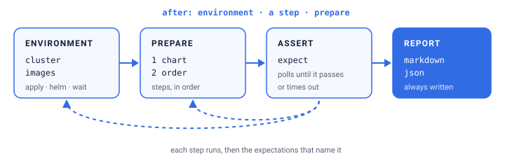

<div align="center">
  

  <p><strong>If it runs in Kubernetes, <code>jig it</code> locally before you ship it.</strong></p>
  <p>Declare a Kubernetes environment and the checks that prove it correct.</p>

  <p>
    <a href="https://github.com/intentd/jig/actions/workflows/ci.yml"></a>
    <a href="https://pkg.go.dev/github.com/intentd/jig"></a>
    
    
  </p>
</div>

A jig is one YAML file: a Kubernetes environment, and the checks that prove it correct. jig provides the cluster, builds and loads the images, installs what the workload depends on, deploys it, checks that it behaves, tears everything down, and always writes a report.

A jig holds the workpiece steady while the tool works on it, so every repeat comes out the same. jig holds the cluster, the images and the dependencies steady while the workload is checked: an operator, a Helm chart, raw manifests or an application image.

## Why

Services that run on Kubernetes are mostly developed against Docker Compose. It's quick to start, but it isn't what production runs: no operators, no Helm charts, a hand-made Postgres in place of the one the platform provides. "It works with Compose" says little about the cluster, and CI rarely runs the Compose file at all.

jig puts the real environment in the repository instead. The platform team, or the developer, writes one `jig.yaml`: the services built from source, the data services from the same operators production uses, the official Helm charts, and the checks both sides care about, down to the log lines that say a service is healthy. Then:

- **The developer** runs `jig it` in the repository, on a laptop, against a throwaway cluster that jig creates and removes.
- **CI** runs the same file, so the jig the developer ran is the one the pipeline runs. Images and charts are signed and published only when it passes.

One file, the same run in both places, and no environment that only exists on someone's machine.

## Install

```console
curl -sSL https://raw.githubusercontent.com/intentd/jig/main/install.sh | bash
```

The script installs the latest release into `~/.jig/bin` and adds it to your `PATH`. It checks every archive against the release's `checksums.txt`, and that file's cosign signature when cosign is installed. `JIG_VERSION` pins a release and `JIG_INSTALL_DIR` changes the directory.

With Homebrew:

```console
brew install intentd/tap/jig
```

From source, with Go: `make build` (see [Building](#building)).

## The model

A complete jig is a Kubernetes environment plus the assertions that prove it correct. Every run has four phases, in order.

| Phase | Question | Where |
| --- | --- | --- |
| **Environment** | What world does the jig run in? | `environment` |
| **Prepare** | What is deployed before, and between, the checks? | `prepare` |
| **Assert** | Is the thing under test behaving? | `expect` |
| **Report** | What was the result? | always written |

<p align="center">
  
</p>

`onFailure` and `finally` run side effects (commands, kubectl, external calls) when something fails and when a run or an expectation ends. Checks can also ask what only a running cluster can show: that something stays true for a while (`stays`), that an object stopped changing (`settles`), that things happened in order (`order`), and that nothing warned or restarted during the run (`guards`).

## A jig

```yaml
name: shop-api
description: The shop API chart, and an order through it

env:
  API_URL: http://shop-api.shop.svc:8080

environment:
  cluster:
    provider: kind          # kind (default) | none
    name: shop-e2e
  images:
    - image: shop-api:dev
      build: { context: ., dockerfile: Dockerfile }
    - image: shop-worker:dev     # already built: loaded as is
  apply:
    - ./e2e/namespaces.yaml

prepare:
  - name: chart
    helm: { chart: ./charts/shop, namespace: shop, values: { image.tag: dev } }
    wait:
      - { kind: Deployment, name: shop-api, namespace: shop, ready: true }
  - name: order
    apply: ./e2e/order.yaml

expect:
  - name: the API is up
    after: chart
    timeout: 60s
    resources:
      - { kind: Deployment, name: shop-api, namespace: shop, ready: true }
  - name: the order is accepted
    after: order
    timeout: 30s
    commands:
      - run: curl -fsS $API_URL/orders/1

finally:
  kubectl:
    logs:
      - { labelSelector: app=shop-api, namespace: shop }

imports:
  - ./e2e/upgrade.yaml
```

Like a GitHub Actions workflow, the file has no `apiVersion` or `kind`: the keys are the document. They are `name`, `description`, `env`, `functions`, `environment`, `prepare`, `expect`, `onFailure`, `finally` and `imports`. The parser is strict: an unknown key is an error, and validation reports every problem at once.

Save it as `jig.yaml` and:

```console
jig validate      # check the file: shape, references, every problem at once
jig plan          # what a run will do, in order, before it does it
jig it            # run it (jig run, if you prefer)
```
Starting from scratch? **`jig init`** writes a starter jig.yaml and its files; jig init --list shows the example packs.

Every command and flag is in [docs/cli.md](docs/cli.md).

## Examples

Each is a real reason to reach for jig, and runs as it is:

| Example | Use case | Shows |
| --- | --- | --- |
| [`commands`](examples/commands/jig.yaml) | A CLI or script, no cluster | `provider: none`, a step's commands, exit codes and output assertions, the env forms, checks split into [nested includes](examples/commands/checks.yaml) |
| [`app-image`](examples/app-image/jig.yaml) | CI for an application image: build it and prove it serves before it is pushed | `images.build`, `deploy`, a port-forward HTTP check, `onFailure` diagnostics |
| [`helm-chart`](examples/helm-chart/jig.yaml) | A chart and its upgrade | `helm` install, then an upgrade with new values and a `restart`, with expectations after each |
| [`manifests`](examples/manifests/jig.yaml) | A migration Job that must complete, then be gone | `environment.apply`, `kubectl.get` and `logs` checks, a `delete` step and a cleanup check |
| [`stack`](examples/stack/jig.yaml) | Several services, the Docker Compose case | an image from a remote repository (`git`), two built here from one entry (`forEach`, build `args`, from an [include file](examples/stack/images.yaml)), deployed in `needs` order; `match` and `expr:` checks |
| [`ecosystem`](examples/ecosystem/jig.yaml) | A workload and the data services it uses | Postgres and Redis from their operators, a job reaching both through the `envFrom` Secret jig writes, `${{ ecosystem.… }}` |
| [`examples`](examples/jig.yaml) itself | One cluster for several tests: the suite of the four | `imports`, `wait`, `freshCluster` |

```console
jig validate examples              # the suite
jig run examples/commands          # no cluster: runs anywhere
jig run examples/helm-chart        # creates a kind cluster, deletes it after
```

`make test` reads and checks every example, and runs `commands`. `make validate-examples` prints each one's plan; `make examples` builds jig and runs the suite.

## Documentation

| | |
| --- | --- |
| [Writing a jig](docs/jig.md) | The environment and images (`git`, `needs`, `forEach`, build `args`), prepare steps and `keep`, expectations, `match` and `expr:`, over time and across the run (`capture`, `stays`, `settles`, `snapshot`, `order`, `repeat`, `guards`), includes, env, imports |
| [Ecosystem](docs/ecosystem.md) | Data services: Postgres, MariaDB, RabbitMQ, Redis, Kafka; their Secrets and `${{ ecosystem.… }}` |
| [The command line](docs/cli.md) | Commands and flags, `./...`, the report (Markdown, JSON, JUnit) |
| [As a library](docs/library.md) | `jig.Run`, `FromFile`, `Plan`, and running your own format through jig. [`examples/library`](examples/library/runjig/main.go) is a runnable program: load, validate, plan, run, report, in about eighty lines |
## Building

```console
make build              # → ~/.jig/bin/jig, stamped with the git version
make test
make validate-examples  # every example checked offline, with its plan
make examples           # the examples suite, on kind
```

jig builds on [tools](https://github.com/intentd/tools), [KEL](https://github.com/intentd/kel) and [kind](https://kind.sigs.k8s.io).
